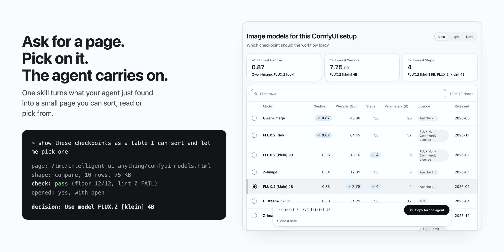
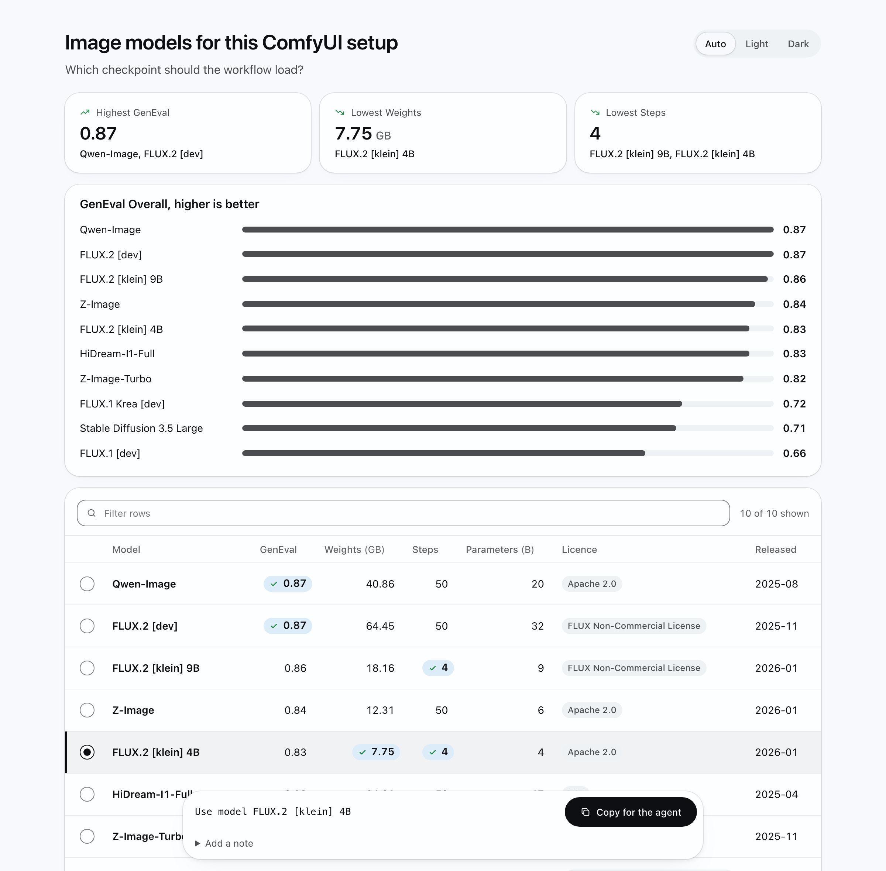
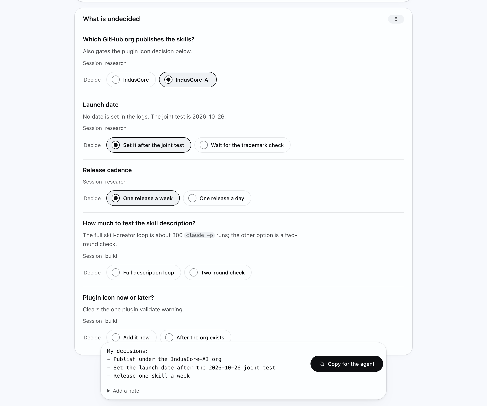
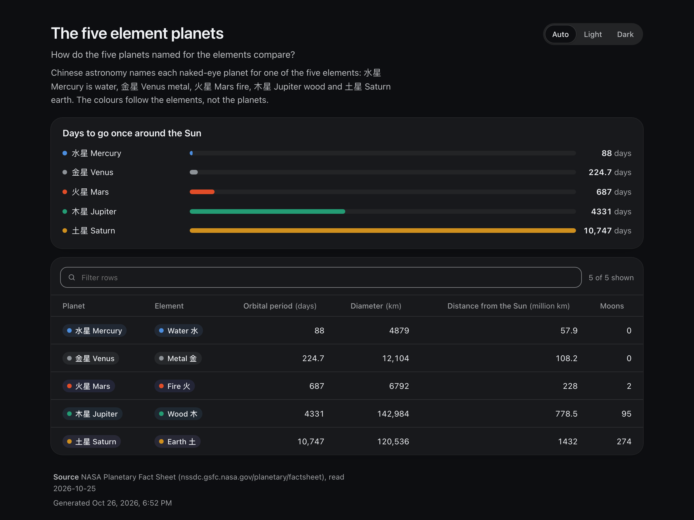

<div align="center">


# Intelligent UI Anything

**Turn what your agent just produced into one small page you can sort, read or pick from, and get your pick back into the session without retyping it.**

[](https://github.com/IndusCore-AI/intelligent-ui-anything/actions/workflows/validate.yml)


[](LICENSE)

Claude Code · Codex CLI · Cursor · Antigravity · claude.ai

[Quick start](#quick-start) · [Examples](#examples) · [Five shapes](#five-shapes) · [How it works](#how-it-works) · [Install](#install) · [Cost](#what-a-page-costs)



</div>

## Why

Agents answer in prose. When the answer is ten models with six attributes each, or twenty findings across three sessions, prose makes you scroll, compare in your head and then type your choice back. This skill gives the agent five locked page templates instead. The agent writes JSON, a script fills the template, checks it, and opens it where you are. You sort, filter and pick. Your pick comes back to the agent as one line, by a Copy button or straight into the session.

- **Five shapes, nothing else.** Compare, choose, explain, track, inspect. A question that fits none gets prose.
- **Looks like an answer, not a report.** Cards, the leaders at a glance, tappable rows and options, status icons, a floating pick dock, and motion that streams in. Light, dark and phone layouts are designed, not shrunk.
- **The decision comes back.** Every pick shows the exact line the agent will get. Served pages send it with one click.
- **Opens where you are.** An artifact in Claude Code, your browser in a terminal, a localhost URL over SSH, a path inside a sandbox.
- **Honest by construction.** A page that states a number its data does not hold fails the check and never opens.
- **Zero dependencies.** Node 18 built-ins, no network, one self-contained HTML file per page, light and dark.

## Quick start

```bash
npx skills add IndusCore-AI/intelligent-ui-anything
```

Then ask the way you would ask a person:

```text
compare these models and let me pick one
lay out the three options for the migration
show me what changed, what's risky and what's undecided across today's sessions
keep a checklist page updated while you run the release
```

Try it without an agent: `node scripts/render examples/comfyui-models.json` opens the example page.

## Examples

Every example is a runnable JSON input in [`examples/`](examples) with real, sourced data.

<table>
  <tr>
    <td width="33%"><a href="examples/comfyui-models.json"></a></td>
    <td width="33%"><a href="examples/post-session-review.json"></a></td>
    <td width="33%"><a href="examples/five-elements.json"></a></td>
  </tr>
  <tr>
    <td><b>Pick a model</b><br><sub><code>compare</code> with a pick. One click hands the agent "Use model FLUX.2 [klein] 4B".</sub></td>
    <td><b>Review three sessions</b><br><sub><code>inspect</code>: what changed, what is risky, and the open items decided on the page.</sub></td>
    <td><b>Colour that means something</b><br><sub>Each planet wears its element (wuxing), checked for contrast in light and dark.</sub></td>
  </tr>
</table>

## Five shapes

| The question | Shape | What you get |
| --- | --- | --- |
| Which of these is best on what matters? | `compare` | sortable, filterable table; optional bar chart; optional pick per row |
| Which one should we do? | `choose` | 2 to 6 option cards with good and watch-out points; one pick |
| What does this say, and what changed? | `explain` | a long document with contents, anchors and a changed-sections view |
| How far along is it? | `track` | a checklist with progress that refreshes while the agent works |
| What happened, what is risky, what is open? | `inspect` | a filterable timeline by lane, severity and session; diffs; decisions |

Colours carry meaning and nothing else: five elements, severity, pass and fail, diff, and finance colours by locale (red is up in China, Taiwan and Japan; green is up in the US). The palettes and their contrast measurements are in [`references/semantics.md`](references/semantics.md).

## How it works

```text
you ask  ──▶  agent picks a shape and writes JSON  ──▶  scripts/render
                                                          │ fills a locked template
                                                          │ checks it (10 floor rules, 2 security rules, Hallmark lint)
                                                          ▼
                    artifact · browser · localhost URL · printed path
                                                          │
you pick  ──▶  "Use model FLUX.2 [klein] 4B"  ──▶  back to the agent (Copy, or Send when served)
```

1. **The agent writes content, never markup.** The template, styles and script are fixed, so every page looks the same, costs less to write and passes the same checks.
2. **The check runs before anything opens.** Tokens only, focus rings, contrast in both themes, phone width, no horizontal scroll, readable without script, no em dashes, no buzzwords, no invented numbers, nothing loaded from the network, no credit or tracking in the page. A failing page is written but not opened, and the agent is told what to fix.
3. **The script reads the environment** and picks where the page goes:

| You are in | The page |
| --- | --- |
| Claude Code with the Artifact tool | becomes an artifact |
| Claude Code on an API key, Bedrock or Vertex, or `claude -p` | opens in your browser |
| Codex CLI (sandboxed) | is written, and the path is printed |
| An SSH session | is served on 127.0.0.1, with the `ssh -L` line printed |
| A Linux box with no display | is written, and the path is printed |

What was measured in each host, and what is still unverified, is in [`references/hosts.md`](references/hosts.md).

## Install

<details open>
<summary><b>Any agent that reads Agent Skills</b> (Claude Code, Codex, Cursor and others)</summary>

```bash
npx skills add IndusCore-AI/intelligent-ui-anything
```
</details>

<details>
<summary><b>Claude Code, as a plugin</b></summary>

```text
/plugin marketplace add IndusCore-AI/intelligent-ui-anything
/plugin install intelligent-ui-anything@intelligent-ui-anything
```
</details>

<details>
<summary><b>Claude Code, by hand</b></summary>

```bash
git clone https://github.com/IndusCore-AI/intelligent-ui-anything ~/.claude/skills/intelligent-ui-anything
```
</details>

<details>
<summary><b>Codex CLI</b></summary>

```bash
git clone https://github.com/IndusCore-AI/intelligent-ui-anything ~/.agents/skills/intelligent-ui-anything
```

Run Codex with `--sandbox workspace-write` (its interactive default). `codex exec` defaults to read-only, where no page can be written.
</details>

<details>
<summary><b>Cursor</b></summary>

```bash
git clone https://github.com/IndusCore-AI/intelligent-ui-anything .cursor/skills/intelligent-ui-anything
```
</details>

<details>
<summary><b>claude.ai</b></summary>

Zip the repo folder (named `intelligent-ui-anything`) and upload it under Settings, Skills, with code execution on.
</details>

It needs Node.js 18 or later and nothing else: no packages, no network. The folder must keep the name `intelligent-ui-anything`, as the Agent Skills spec requires.

## What a page costs

Measured on 2026-10-25 as the output tokens Claude Opus 5.5 spends writing the content, tool overhead subtracted:

| Content | As plain text | As a page with this skill | As hand-written HTML |
| --- | ---: | ---: | ---: |
| Review of three sessions, 20 items | 1,223 | 2,262 | 4,450 |
| ComfyUI comparison, 10 rows | 802 | 1,293 | not measured |

A page costs less than twice the plain answer and about half a page written by hand. Loading the skill adds about 3,500 input tokens once per session. In a plain `claude -p` run, the review page was on disk in 33 seconds.

## What it does not do

- It does not build or edit your app's UI. It makes throwaway pages that answer one question.
- No panel inside VS Code yet. Pages open in the browser.
- No inline rendering inside ChatGPT or Perplexity. The Codex app has its own inline surface; this skill writes a page file there instead.
- Windows, WSL, Cursor and Antigravity paths are written but not yet run. [`references/hosts.md`](references/hosts.md) says what was measured where.

## Development

```bash
node tests/run                 # unit, floor and CLI tests
node scripts/check --templates # the floor on all five templates
```

Why the build differs from its brief, with the evidence, is in [`DECISIONS.md`](DECISIONS.md). Changes are in [`CHANGELOG.md`](CHANGELOG.md).

## Licence

MIT, copyright IndusCore. `scripts/vendor/hallmark/` is Hallmark's sloplint, MIT, copied unchanged from a named commit.

"Intelligent UI" is also the name of a ChatGPT feature. Not affiliated with OpenAI.

Built by IndusCore, [induscore.site](https://induscore.site).
